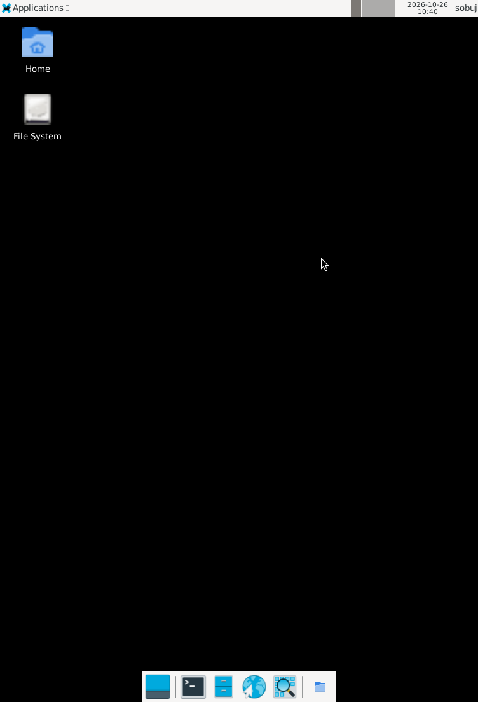

# Debian nested XFCE startup fix and live check

Observed 2026-10-26 10:37–10:41 UTC on the Redmi Turbo 4 Pro, Native Termux host. Repository source before this change was `d493b85`. Native XFCE was already running on `:1`; the receipt-verified Debian Trixie replay guest `ternuxx-replay-cleanroom-20261026` and user `sobuj` were already installed. No rootfs or package was changed.

## Startup regression and correction

The first authorized nested launch, `tx pgui start --mode nested --desktop xfce --alias ternuxx-replay-cleanroom-20261026`, reached Xephyr setup then exited because the embedded guest payload referenced host-only `DISTRO_ID` under `set -u`. The failure was reproduced on the physical device. The payload now receives `TERNUXX_PROOT_ALIAS` explicitly in both supported PRoot invocation paths, and its status message reads that guest-side variable. `tests.test_proot_gui_routing` now asserts the payload receives the selected alias and never references the host-only variable.

The corrected live command started the nested Debian XFCE session on Xephyr `:2` while Native XFCE stayed on `:1`. `xdpyinfo` reported a 752x1104 X server. The `xfce4-session`, `xfwm4`, `xfce4-panel`, and `xfdesktop` clients were visible on `:2`; the captured Xephyr window shows the desktop and panel in [the nested XFCE screenshot](proot-nested-xfce-live.png).

## Workload results

`tx proot verify --distro ternuxx-replay-cleanroom-20261026 --guest-user sobuj --display :2 --backend zink` returned `partial`:

- GLES context: Zink/Vulkan 1.4 on `Adreno (TM) 825 (MESA_TURNIP)`, OpenGL ES 3.2 / Mesa 25.0.7.
- Bounded Vulkan draw: verified on Adreno 825 (`IntegratedGpu`).
- GLX: Xephyr DRI3 unavailable; bounded GLX draw failed with 0 frames.
- GLES draw: not verified by this run.
- Native PulseAudio endpoint: reachable at `tcp:127.0.0.1:4713`, default sink `OpenSL_ES_sink`.

A bounded low-level guest `paplay` tone test returned 0; verbose PulseAudio output said the stream connected to Native `OpenSL_ES_sink`. The `OpenSL_ES_sink.monitor` capture returned silence/no usable samples, so the audio signal at the device output and audible playback remain unverified. No audio package, sink, volume, or service configuration was changed.

Ctrl-C exited only the nested launcher with its expected status 130. Follow-up `tx pgui status` reported `:2` absent and Native desktop running; `tx audio status --json` still reported the Native-owned service running. The standalone `:0` session remained stopped.

## Validation and remaining scope

Shell syntax and the focused routing/management group passed (102 tests). The full `env -u LD_LIBRARY_PATH PYTHONDONTWRITEBYTECODE=1 bash scripts/repo_test.sh` suite passed against this source change: 1,223 tests in 201.012 seconds. Document inventory, README bridge, `repo_knowledge verify`, and `git diff --check` also passed. This check confirms nested XFCE session startup and an Adreno-backed Vulkan workload; it does not qualify nested GLX/GLES drawing, Android foreground presentation, or audible playback.

